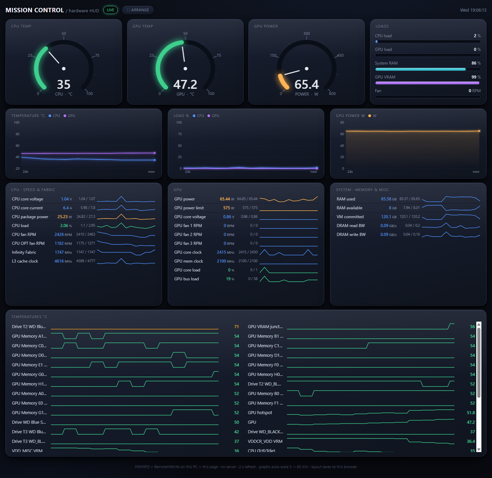

# Mission Control — Hardware HUD

A single-file hardware dashboard for HWiNFO. **No server, no install, no cloud.**
Download one HTML file, double-click it, watch your PC live.



It shows: CPU/GPU temperature and power gauges, load bars, 60-minute history
charts, per-sensor pick lists (voltages, currents, clocks, fan RPM, DRAM
bandwidth, DIMM voltages) with now / min / max / trend, and every temperature
sensor on the box (drives, VRM, chipset, DIMMs, hotspots) with heat-coloured
trends. Blocks are draggable, resizable and reorderable — your layout is saved
in the browser.

Everything stays on your machine. The page reads a local feed over
`http://127.0.0.1:60000` and never contacts anything else.

## What you need (once, ~2 minutes)

The HUD itself needs nothing — but it reads sensors, so two small tools must be
running on the same PC:

1. **[HWiNFO64](https://www.hwinfo.com/download/)** — the sensor engine.
   - In *Preferences* make sure **Enable shared memory support** is ticked.
   - Keep the **Sensors window** open (minimised is fine — closing it stops the feed).
2. **[RemoteHWInfo v0.5](https://github.com/Demion/remotehwinfo/releases/download/v0.5/RemoteHWInfo_v0.5.zip)** — turns HWiNFO's shared memory into a local web feed.
   - Download the zip and extract it anywhere.
   - Run it with this command (full sensor feed, no GPU-Z dependency):

     ```
     remotehwinfo.exe -port=60000 -gpuz=0
     ```

   - First run: allow it through the Windows Firewall prompt (private networks).

3. **Open `index.html`** — double-click it. Badge turns green: **LIVE**.

> Tip: put shortcuts for HWiNFO (with *Run at startup* in its settings) and
> RemoteHWInfo (command above) in your Startup folder
> (`Win+R` → `shell:startup`) and the dashboard will always have data.

## Using it

- **⛶ arrange** (top bar) — drag blocks anywhere, drag the corner grip to
  resize, drag rows up/down inside a block to reorder. Saved automatically;
  *reset layout* restores the default.
- Graphs auto-scale from 5 minutes up to 60 minutes as data accumulates.
- Min / max columns cover the current session (since the page was opened).
- Temperature sparklines trend green → amber → red with heat.

## Options

- **Another machine's feed:** open
  `index.html?feed=http://192.168.1.50:60000/json.json`
  (the choice is remembered; `?feed=` always wins).
- **Browser refuses to load the feed from `file://`** (rare, some hardened
  settings): serve the folder with any static server, or just use the GitHub
  Pages link for this repo — both send a normal origin and the feed allows it.

## Troubleshooting

| Symptom | Cause / fix |
|---|---|
| Badge says **NO FEED** | RemoteHWInfo isn't running, or HWiNFO's sensors window is closed. Start both, then refresh. |
| Badge LIVE but panels say *empty feed* | RemoteHWInfo was started without `-gpuz=0`, or HWiNFO shared memory is disabled in Preferences. |
| Values fine but some rows missing | That sensor isn't enabled in HWiNFO (Sensors window → right-click → Sensor settings). GPU Hot Spot, for example, is a per-VBIOS option. |
| Works, then goes OFFLINE whenever another dashboard opens | RemoteHWInfo serves **one client at a time**. Close the other. |
| A `%` row shows a wild number | Send a screenshot — the page guards against unit mix-ups, this would be a new one. |

## Privacy

The page is plain HTML/JS with no dependencies, no analytics, no network calls
except the sensor feed you point it at (default: your own PC). View source —
that's all there is.

---

Built by [JoscarTheDane](https://github.com/JoscarTheDane). MIT — do what you like with it.
